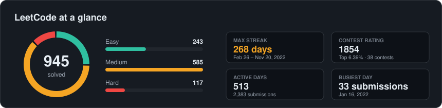
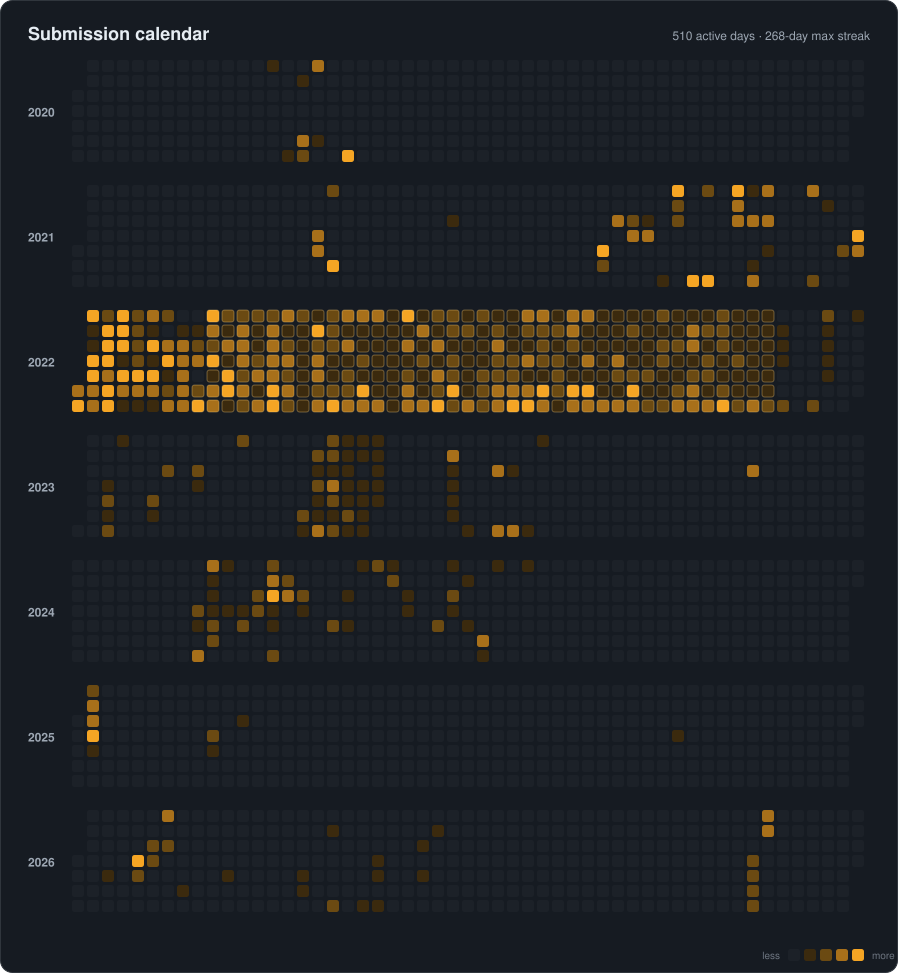
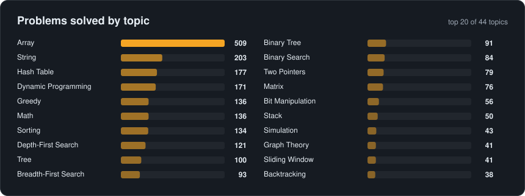
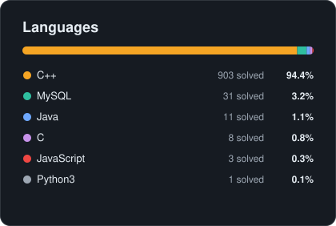
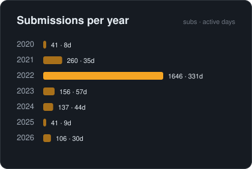

# ⚡ LeetCode Insights

**937 problems solved · 268-day max streak · 1854 contest rating (top 6.38%)**

## 🔥 Consistency

- **Longest streak:** 268 days in a row, from Feb 26, 2022 to Nov 20, 2022
- **Active days:** 509 days with 2,362 submissions in total
- **Busiest day:** Jan 16, 2022, with 33 submissions
- **Most active weekday:** Sunday

## 🧠 Topics

<b>All 44 topics</b>

| Topic | Solved |
|---|---|
| Array | 512 |
| String | 203 |
| Hash Table | 178 |
| Dynamic Programming | 172 |
| Math | 137 |
| Greedy | 136 |
| Sorting | 135 |
| Depth-First Search | 121 |
| Tree | 100 |
| Breadth-First Search | 93 |
| Binary Tree | 91 |
| Binary Search | 84 |
| Two Pointers | 79 |
| Matrix | 76 |
| Bit Manipulation | 58 |
| Stack | 50 |
| Simulation | 43 |
| Graph Theory | 41 |
| Sliding Window | 41 |
| Backtracking | 38 |
| Linked List | 36 |
| Database | 31 |
| Design | 29 |
| Union-Find | 29 |
| Divide and Conquer | 22 |
| Recursion | 20 |
| Enumeration | 16 |
| Trie | 15 |
| Monotonic Stack | 15 |
| Ordered Set | 14 |
| Game Theory | 14 |
| Queue | 12 |
| Topological Sort | 10 |
| Binary Indexed Tree | 9 |
| Segment Tree | 9 |
| Bitmask | 7 |
| Quickselect | 5 |
| Shortest Path | 5 |
| Brainteaser | 4 |
| Monotonic Queue | 4 |
| Iterator | 3 |
| Data Stream | 3 |
| Rolling Hash | 3 |
| Sweep Line | 2 |

## 💻 Languages & 📈 Yearly activity

  
  

**Difficulty split:** 243 easy · 577 medium · 117 hard. Hard problems are 12.5% of all solved.

## 📂 Hand-picked problems by topic

129 problems, no repeats across topics. They're chosen for quality: well-liked and mostly Medium/Hard.
Each folder contains my **last accepted submission** with its runtime and memory stats.

| Topic | Solved in topic | Picked | Easy / Med / Hard |
|---|---|---|---|
| [Linked List](./problems/01-linked-list/) | 36 | 10 | 0 / 8 / 2 |
| [Backtracking](./problems/02-backtracking/) | 38 | 10 | 0 / 6 / 4 |
| [Sliding Window](./problems/03-sliding-window/) | 41 | 10 | 0 / 6 / 4 |
| [Graph](./problems/04-graph/) | 41 | 10 | 0 / 2 / 8 |
| [Bit Manipulation](./problems/05-bit-manipulation/) | 58 | 13 | 0 / 11 / 2 |
| [Stack](./problems/06-stack/) | 50 | 10 | 0 / 5 / 5 |
| [Two Pointers](./problems/07-two-pointers/) | 79 | 10 | 0 / 9 / 1 |
| [Binary Search](./problems/08-binary-search/) | 84 | 12 | 0 / 8 / 4 |
| [Tree](./problems/09-tree/) | 100 | 10 | 0 / 8 / 2 |
| [Greedy](./problems/10-greedy/) | 136 | 10 | 0 / 4 / 6 |
| [String](./problems/11-string/) | 203 | 11 | 0 / 7 / 4 |
| [Dynamic Programming](./problems/12-dynamic-programming/) | 172 | 13 | 0 / 5 / 8 |

Stats snapshot: Nov 17, 2026
